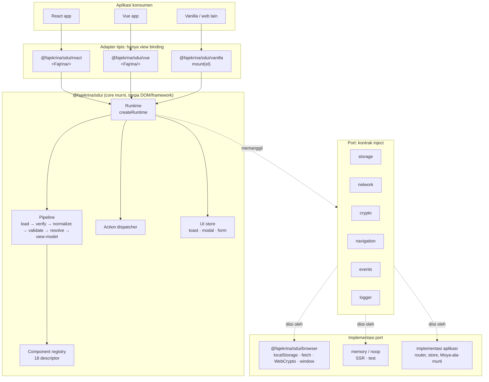
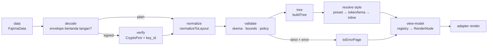
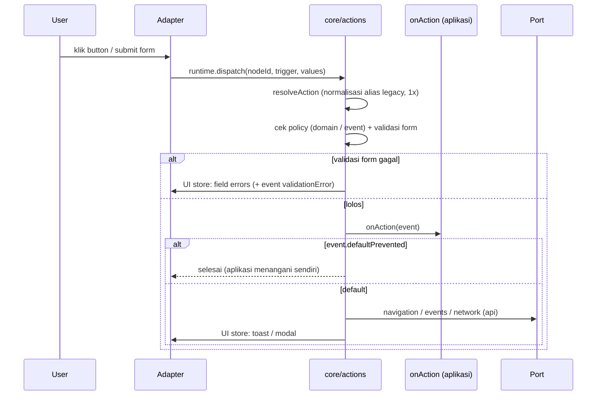
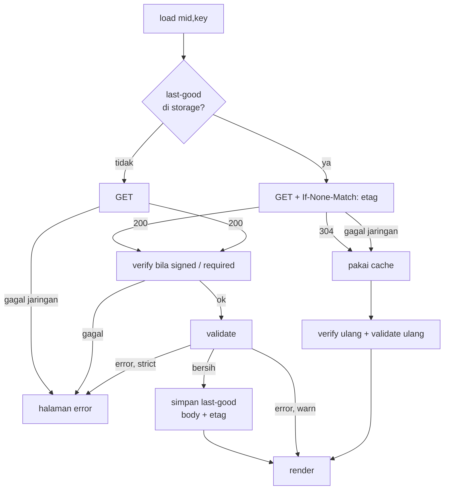

# Desain Sistem: @fajekrina/sdui sebagai Framework Berlapis

> Status: desain siap implementasi · Tanggal: 2026-11-10 · Versi paket saat ini: 0.2.0
> Turunan dari `MIGRASI-FRAMEWORK-BERLAPIS.md` (rencana fase). Dokumen ini mendefinisikan **arsitektur, kontrak, dan gerbang kualitas**-nya.
> Pasangan backend: `DESAIN-SISTEM-SDUI.md` (3 artefak blob, S1 + A1, payload beku per release).
> Pola: **framework-agnostic core + port yang di-inject + adapter tipis** (ports & adapters / headless core).

---

## 1. Tujuan dan batasan

**Tujuan**
1. Satu core murni yang memegang **semua** keputusan: validasi, keamanan, cache, resolusi style/tema, aksi, state UI (toast/modal/form).
2. Adapter React, Vue, dan vanilla hanya mengikat **view**: render node yang sudah final + teruskan event. Visual dan perilaku identik karena keputusannya hanya dibuat di satu tempat.
3. Aman dipakai di browser, SSR, dan test tanpa perubahan kode (semua efek samping lewat port).
4. API stabil menuju 1.0 dengan semver disiplin.

**Bukan tujuan**
- Router atau store global bawaan: tetap milik aplikasi konsumen, disambungkan lewat port.
- Menjalankan kode arbitrer dari payload: aksi tetap kosakata tertutup.
- Port kode murti (SwiftUI, Figma plugin, DSL Swift): yang diambil hanya semantiknya (bounds, urutan lapis, fail-soft/closed).

## 2. Kondisi hari ini (as-is)

| Area | Temuan | Bukti |
|---|---|---|
| Efek samping di adapter | `window.open`, `history.back`, `document.dispatchEvent(CustomEvent)` | `src/react/Fajrina.tsx:154-172`, `src/vue/Fajrina.vue:88-104` |
| DOM query di adapter Vue | form membaca nilai via `document.querySelector` | `src/vue/Fajrina.vue:124,133` |
| Logika aksi terduplikasi | `emit()` + resolusi alias legacy (`props.action` string, `url`, `props.behavior`, `comp.action`) ditulis ulang di React dan Vue | `src/react/Fajrina.tsx:136-176` dan padanannya di Vue |
| Render per tipe terduplikasi | `switch` 18 tipe di tiap adapter; tag HTML, atribut, dan state form diputuskan adapter | `src/react/Fajrina.tsx:180-310` |
| Global di core | `fetch` global di helper, `globalThis.localStorage` di cache, `globalThis.crypto` di sign | `src/core/index.ts:19-50`, `src/core/cache.ts:30`, `src/core/sign.ts:47` |
| Yang sudah benar | resolver style tunggal (`buildLayoutStyle`, `applyThemeToStyle`), validasi + `SduiError`, `toErrorPage`, last-good cache, verifikasi Ed25519, builder headless tanpa DOM | `src/core/*`, `src/builder/builder.ts` |
| Adapter vanilla | diklaim README, belum ada sebagai renderer | `README.md:14` |
| Dokumentasi paket | README memakai nama `fajrina-sdui`, paket sebenarnya `@fajekrina/sdui` | `README.md`, `package.json` |
| Test | vitest: core (tree/style/validate/theme/cache/sign) + React; belum ada paritas React-vs-Vue | `tests/` |

Kesimpulan: core sudah memegang **style dan validasi**, tetapi **perilaku** (aksi, form, toast/modal) dan **keputusan render** (tag, atribut) masih tinggal di adapter, ditulis dua kali.

## 3. Arsitektur target

### 3.1 Lapisan



Aturan ketergantungan (ditegakkan CI, §9):
- `core` → tidak boleh mengimpor `react`, `vue`, atau memakai `window / document / localStorage / fetch / crypto / navigator / history` secara langsung.
- `adapter` → boleh mengimpor `core` dan framework-nya; **tidak** boleh berisi cabang `behavior ===`, nilai warna/ukuran, atau aturan validasi.
- `browser` → satu-satunya modul yang menyentuh API browser; tidak bergantung pada framework.

### 3.2 Struktur modul

```
src/
├── core/                     entry "."
│   ├── types.ts              (ada) UniversalPageConfig, FajrinaData, …
│   ├── tree.ts               (ada) buildTree, normalizeLayoutToTree
│   ├── style.ts              (ada) buildLayoutStyle, TOKENS
│   ├── theme.ts              (ada) applyThemeToStyle, resolveThemeTokens
│   ├── validate.ts           (ada) validateData, SduiError, DEFAULT_BOUNDS, toErrorPage
│   ├── props.ts              (ada) ComponentPropsMap
│   ├── sign.ts               (ada) verifyEnvelope → pakai CryptoPort
│   ├── cache.ts              (ada) loadPageWithCache → pakai StoragePort
│   ├── ports.ts              (baru) kontrak port + noop/memory default
│   ├── registry.ts           (baru) descriptor 18 tipe → element, atribut, aturan
│   ├── view-model.ts         (baru) TreeNode → RenderNode final
│   ├── actions.ts            (baru) resolveAction, dispatcher, chain
│   ├── ui-store.ts           (baru) toast, modal, form state (subscribe)
│   ├── loader.ts             (baru) fetch + ETag + verify + last-good
│   └── runtime.ts            (baru) createRuntime: merakit semua di atas
├── browser/                  entry "./browser" (baru)
│   └── index.ts              browserPorts(): localStorage, fetch, WebCrypto, window, document
├── react/                    entry "./react"   <Fajrina/> + useSduiRuntime
├── vue/                      entry "./vue"     <Fajrina/> + useSduiRuntime
├── vanilla/                  entry "./vanilla" (baru) mount(el, options)
└── builder/                  entry "./builder", "./builder/react", "./builder/vue" (ada)
```

Entry naik dari 6 menjadi 8 (`./browser`, `./vanilla`). Keduanya punya alasan yang tidak bisa dipenuhi entry lain: `browser` harus terpisah dari core agar core tetap bebas DOM, dan `vanilla` adalah adapter ketiga yang dijanjikan README.

## 4. Kontrak inti

### 4.1 Port

```ts
// src/core/ports.ts — kontrak; core hanya mengenal interface ini
export interface StoragePort {
  get(key: string): string | null | Promise<string | null>
  set(key: string, value: string): void | Promise<void>
  remove(key: string): void | Promise<void>
}

export interface NetworkPort {
  /** GET halaman; `etag` → If-None-Match. 304 dikembalikan sebagai { status: 304 }. */
  getPage(req: { merchantId: string; pageKey: string; etag?: string; signal?: AbortSignal }):
    Promise<{ status: number; body?: unknown; etag?: string }>
  /** Hanya untuk action `api` (Fase 2). URL wajib lolos policy.allowedDomains sebelum dipanggil. */
  request?(req: { method: 'GET' | 'POST' | 'PUT' | 'DELETE'; url: string; body?: unknown; signal?: AbortSignal }):
    Promise<{ status: number; body?: unknown }>
}

export interface CryptoPort {
  verifyEd25519(publicKey: Uint8Array, data: Uint8Array, signature: Uint8Array): Promise<boolean>
  sha256(data: Uint8Array): Promise<Uint8Array>
}

export interface NavigationPort {
  navigate(target: string, params?: Record<string, unknown>): void   // router aplikasi
  back(): void
  openExternal(href: string): void                                    // sudah lolos allow-list
}

export interface EventPort {
  emit(name: string, detail?: Record<string, unknown>): void          // customEvent (sudah lolos allow-list)
}

export interface LoggerPort {
  warn(message: string, detail?: unknown): void
  error(message: string, detail?: unknown): void
}

export interface SduiPorts {
  storage?: StoragePort; network?: NetworkPort; crypto?: CryptoPort
  navigation?: NavigationPort; events?: EventPort; logger?: LoggerPort
}
```

Default bila port tidak diberikan:

| Port | Di browser (adapter memanggil `browserPorts()`) | SSR / test |
|---|---|---|
| storage | `localStorage`, jatuh ke memori bila diblokir | memori |
| network | `fetch` ke `baseUrl` (default `/api/universal`) | tidak ada: `load()` gagal dengan `SduiError network` |
| crypto | WebCrypto | tidak ada: verifikasi `required` gagal tertutup |
| navigation | `navigate` = hanya event `onAction` (tidak menebak router); `back` = `history.back`; `openExternal` = `window.open(…, 'noopener')` | noop |
| events | `document.dispatchEvent(new CustomEvent(...))` | noop |
| logger | `console` | `console` |

`navigate` sengaja **tidak** diberi implementasi default yang mengubah URL: SDUI tidak tahu router aplikasi. Perilaku hari ini (hanya `onAction`) dipertahankan.

### 4.2 Runtime

```ts
export interface RuntimeOptions {
  ports?: SduiPorts
  theme?: UniversalTheme
  policy?: SduiPolicy                 // dari aplikasi (dipercaya)
  mode?: 'warn' | 'strict'            // default 'warn'
  bounds?: SduiBounds                 // default DEFAULT_BOUNDS
  verify?: { publicKeys: Record<string, Uint8Array>; required: boolean }
  onAction?: (event: FajrinaActionEvent) => void
}

export interface SduiRuntime {
  /** Ambil + verifikasi + validasi + cache. Tidak pernah throw: hasil gagal = halaman error. */
  load(src: { merchantId: string; pageKey: string; signal?: AbortSignal }): Promise<LoadResult>
  /** Murni & sinkron: data → pohon RenderNode final. Dipakai SSR dan semua adapter. */
  render(data: FajrinaData): RenderResult
  /** Jalankan aksi dari node (dipanggil adapter saat klik/submit). */
  dispatch(nodeId: string, trigger: 'click' | 'submit', formValues?: Record<string, string>): Promise<void>
  /** State UI (toast, modal, error form) + langganan perubahan. */
  getState(): UiState
  subscribe(listener: () => void): () => void
  setFieldValue(formId: string, name: string, value: string): void
  destroy(): void
}

export function createRuntime(options?: RuntimeOptions): SduiRuntime
```

`render` tidak bergantung pada `load`: aplikasi yang sudah punya data (mis. dari SSR) cukup memanggil `render(data)`. Ini menjaga kontrak `<Fajrina data={…}/>` hari ini.

### 4.3 RenderNode: kontrak core → adapter

Inilah perubahan terpenting. Hari ini tiap adapter memutuskan sendiri tag, atribut, dan style dari 18 tipe. Target: core menghasilkan node yang **sudah final**, adapter merender secara generik.

```ts
export interface RenderNode {
  key: string                                   // id komponen (stabil untuk reconciliation)
  type: UniversalComponentType                  // untuk debug / data-attribute
  element: 'div' | 'section' | 'h1' | 'h2' | 'h3' | 'h4' | 'h5' | 'h6' | 'p' | 'span'
         | 'img' | 'a' | 'button' | 'form' | 'input' | 'select' | 'textarea' | 'label' | 'hr'
  attrs: Record<string, string | number | boolean>   // sudah disanitasi (href/src lolos allow-list)
  style: Record<string, string>                 // final: preset → shared/token → inline sudah diterapkan
  text?: string                                 // isi teks (selalu di-escape adapter, tidak pernah innerHTML)
  options?: Array<{ label: string; value: string }>   // khusus select
  field?: { formId: string; name: string }      // input/select/textarea terikat ke UI store
  action?: { trigger: 'click' | 'submit' }      // ada → adapter memasang handler ke runtime.dispatch
  children: RenderNode[]
}

export interface RenderResult {
  root: RenderNode | null
  errors: SduiError[]                           // mode warn: render tetap jalan
  failed: boolean                               // mode strict + error → root = halaman error
}
```

Konsekuensi:
- **Registry core** (`registry.ts`) memegang satu descriptor per tipe: element, pemetaan props → attrs/text, apakah menerima children, aksi apa yang diizinkan. Menambah tipe = menambah 1 descriptor, bukan 3 cabang switch.
- Adapter React/Vue/vanilla masing-masing cukup **satu** fungsi rekursif `renderNode(node)` (± 40 baris), tanpa pengetahuan tipe.
- Tipe asing → descriptor Null-Object (tidak render; marker hanya di development), sama seperti 0.2.0.
- Keamanan: `text` dirender sebagai teks, `attrs` hanya dari daftar atribut yang diizinkan descriptor (tidak ada `on*`, `style` string, atau `innerHTML`).

### 4.4 Pipeline render



Urutan menang style tidak berubah: **inline > token (via tema) > preset bawaan**. Backend (`DESAIN-SISTEM-SDUI.md`) sudah meratakan shared style + token artefak ke `style`, jadi untuk payload A1 core hanya menerapkan preset + tema aplikasi.

### 4.5 Action dispatcher



Aturan dispatcher:
1. **Normalisasi alias satu kali** (`resolveAction`): `props.action` string, `url → href`, `props.behavior`, `comp.action` diubah ke bentuk `UniversalAction` resmi + `logger.warn` deprecation. Adapter tidak lagi membaca alias.
2. **`onAction` dulu, efek default kemudian**, dan aplikasi bisa membatalkan default lewat `event.preventDefault()`. Ini pengganti cara hari ini (efek browser selalu jalan setelah `onAction`).
3. **Policy sebelum efek**: `externalLink` dan URL action `api` wajib lolos `allowedDomains`; `customEvent` wajib lolos `allowedEvents`. Gagal = tidak ada efek + `SduiError unlistedDomain/unlistedEvent` ke logger dan `onAction` (`behavior: 'blocked'`).
4. **Chain linear** (Fase 2): `onSuccess` / `onError` berisi satu aksi, kedalaman ≤ `bounds.maxChainDepth` (4); tidak ada percabangan atau loop.
5. **Form** dikelola UI store: nilai, error per field dari `required / minLength / maxLength / validation[]` di props. Submit membawa nilai dari store, bukan `document.querySelector`.

### 4.6 UI store

State kecil yang bisa dilanggan, tanpa framework:

```ts
export interface UiState {
  toasts: Array<{ id: string; message: string }>
  modal: { id: string; title?: string; message?: string } | null
  forms: Record<string, { values: Record<string, string>; errors: Record<string, string> }>
}
```

Adapter mengikat: React lewat `useSyncExternalStore(runtime.subscribe, runtime.getState)`, Vue lewat `shallowRef` + `subscribe`, vanilla lewat render ulang subtree terdampak. Komponen Toast dan Modal tetap dirender adapter, tetapi isinya dari store.

### 4.7 Loader: cache, ETag, verifikasi



- Kunci cache tetap `fajrina-page:{mid}:{key}` (kompatibel 0.2.0); isi ditambah `etag`.
- `etag` = `content_hash` release backend (`DESAIN-SISTEM-SDUI.md §6.4`), jadi 304 berarti release tidak berubah.
- Isi cache **diverifikasi ulang tiap load**: menukar isi `localStorage` tidak bisa melewati signature.
- Hanya payload yang lolos validasi bersih yang disimpan sebagai last-good (perilaku 0.2.0 dipertahankan).

### 4.8 Policy dari dua sumber

Payload backend membawa `policy`, dan aplikasi bisa memberi prop `policy`. Aturan gabung: **prop aplikasi adalah batas atas**; policy payload hanya boleh mempersempit.

```
efektif.allowedDomains = prop ? irisan(prop, payload ?? prop) : payload ?? []
```

Alasan: payload datang dari jaringan (bisa dipalsukan bila tidak bertanda tangan), sedangkan prop ditulis developer aplikasi.

## 5. API publik

### 5.1 React (Vue analog)

```tsx
import { Fajrina } from '@fajekrina/sdui/react'

// A. data sudah ada (kontrak 0.2.0, tetap berlaku)
<Fajrina data={page} theme={brandTheme} policy={policy} mode="warn" onAction={handle} />

// B. biarkan runtime yang memuat (baru)
<Fajrina source={{ merchantId: 'merchant_demo', pageKey: 'home' }}
         ports={{ navigation: { navigate: (t, p) => router.push({ name: t, query: p }), back: () => router.back(),
                                openExternal: (h) => window.open(h, '_blank', 'noopener') } }}
         verify={{ publicKeys: { k1: pubKey }, required: true }}
         onAction={handle} />

// C. runtime dipakai bersama beberapa komponen
const runtime = useSduiRuntime({ theme, policy, ports })
<Fajrina runtime={runtime} data={page} />
```

| Prop | Tipe | Default | Catatan |
|---|---|---|---|
| `data` | `FajrinaData` | — | salah satu dari `data` / `source` wajib |
| `source` | `{ merchantId, pageKey }` | — | memakai `runtime.load` |
| `theme` | `UniversalTheme` | preset | |
| `policy` | `SduiPolicy` | dari payload | batas atas (§4.8) |
| `mode` | `'warn' \| 'strict'` | `'warn'` | |
| `ports` | `SduiPorts` | `browserPorts()` di browser | |
| `verify` | `{ publicKeys, required }` | tidak verifikasi | |
| `runtime` | `SduiRuntime` | dibuat internal | untuk berbagi state |
| `onAction` | `(e) => void` | — | `e.preventDefault()` membatalkan efek default |
| `className`, `style` | | | wrapper |

### 5.2 Vanilla

```ts
import { mount } from '@fajekrina/sdui/vanilla'
import { browserPorts } from '@fajekrina/sdui/browser'

const view = mount(document.getElementById('app')!, {
  source: { merchantId: 'merchant_demo', pageKey: 'home' },
  ports: browserPorts({ baseUrl: '/api/universal' }),
  onAction: (e) => console.log(e)
})
view.update(newData)   // render ulang
view.destroy()         // lepas listener + subscribe
```

### 5.3 Core (tanpa framework, mis. SSR)

```ts
import { createRuntime } from '@fajekrina/sdui'
const rt = createRuntime({ theme, mode: 'strict' })
const { root, errors } = rt.render(pageFromDb)   // RenderNode murni → serialisasi ke HTML di server mana pun
```

Ekspor 0.2.0 yang sudah ada (`buildLayoutStyle`, `buildTree`, `validateData`, `applyThemeToStyle`, `verifyEnvelope`, `loadPageWithCache`, …) **tetap diekspor** dengan signature yang sama sampai 1.0. Yang membaca global diberi parameter port opsional; tanpa parameter perilakunya sama seperti sekarang.

## 6. Builder

- `./builder` (headless, sudah bebas DOM) memakai `createRuntime().render` untuk pratinjau, sehingga pratinjau builder == hasil client.
- Palette dari registry core; bila backend menyediakan `GET /merchant/component-types` (`DESAIN-SISTEM-SDUI.md §7`), daftar itu menyaring tipe yang `enabled`.
- Validasi di builder = `validateData` yang sama dengan client + backend, sehingga error muncul sebelum simpan.
- `FajrinaBuilder` React/Vue tetap di adapter; hanya UI editor, tanpa logika aksi/style sendiri.

## 7. Keamanan

| Ancaman | Kendali | Lapis |
|---|---|---|
| Payload dipalsukan di jaringan / cache | Envelope Ed25519, `key_id` → `publicKeys`, verifikasi tiap load termasuk dari cache, `required` = fail-closed | loader |
| Link/redirect ke domain asing | `allowedDomains` sebelum `openExternal`, `Link.href`, `Image.src`, action `api` | dispatcher + view-model |
| Event ke kode aplikasi yang tak diharapkan | `allowedEvents` sebelum `events.emit` | dispatcher |
| XSS | tidak ada `innerHTML`; `text` di-escape; `attrs` dari daftar putih per descriptor; `href` hanya `http(s)`, `mailto`, `tel`, path relatif | view-model |
| Payload raksasa / pohon dalam | `bounds` (depth 32, nodes 5000, …) sebelum render | validate |
| Overlay palsu antar merchant | backend menolak saat simpan; core mengabaikan `position: fixed` di luar Modal/Toast | backend + resolve style |
| Policy payload melonggarkan izin | prop aplikasi = batas atas (§4.8) | runtime |

## 8. Kompatibilitas dan deprecation

| Hal | 0.3 – 0.x | 1.0 |
|---|---|---|
| `<Fajrina data theme policy mode onAction>` | tetap | tetap |
| Alias aksi legacy (`props.action` string, `url`, `props.behavior`, `comp.action`) | diterima + `logger.warn` deprecation | dihapus (payload backend sudah bentuk resmi sejak 0.2.0) |
| Efek default berjalan walau `onAction` menangani | tetap (default) | tetap, kini bisa dibatalkan `preventDefault()` |
| `fetchUniversalPage*` helper | deprecated, diganti `runtime.load` / `NetworkPort` | dihapus |
| Kunci cache `fajrina-page:{mid}:{key}` | tetap, isi ditambah `etag` | tetap |
| Nama paket di README | diperbaiki ke `@fajekrina/sdui` | — |

Aturan: tidak ada breaking change di luar major setelah 1.0; setiap deprecation minimal satu minor dengan peringatan runtime sebelum dihapus.

## 9. Gerbang kualitas (CI)

| Gerbang | Alat | Batas |
|---|---|---|
| Larangan import/global di core | ESLint `no-restricted-imports` (react, vue) + `no-restricted-globals` (window, document, localStorage, fetch, crypto, navigator, history) + test grep cadangan | 0 pelanggaran |
| Paritas adapter | satu fixture → `render()` snapshot RenderNode; React, Vue, vanilla → snapshot DOM, dibandingkan satu sama lain | identik untuk `fixtures/valid/*.json` + 3 halaman `merchant_demo` |
| Fixture invalid | `fixtures/invalid/*` menghasilkan kode `SduiError` yang diharapkan | sesuai |
| Unit test | vitest | coverage core ≥ 80% baris |
| Typecheck | `tsc --noEmit` (src + tests) | 0 error |
| Ukuran bundle | `size-limit` | core < 10 KB gzip; tiap adapter < 4 KB gzip di luar core |
| Kebenaran paket | `publint` + `@arethetypeswrong/cli` | 0 masalah di 8 entry (ESM + CJS + d.ts) |
| SSR | render core + React `renderToString` di Node tanpa jsdom | tidak menyentuh global browser |

## 10. Rencana fase

| Fase | Versi | Isi | Selesai bila |
|---|---|---|---|
| **0 — Pagar** | 0.2.x | Lint + test larangan core; snapshot paritas React-vs-Vue atas fixture; bekukan daftar ekspor publik (test ekspor); perbaiki README | CI merah bila core menyentuh DOM atau React ≠ Vue |
| **1 — Core memegang perilaku** | 0.3.0 | `ports.ts` + `./browser`; `actions.ts` (resolveAction, dispatcher, preventDefault, policy check); `ui-store.ts` (toast/modal/form); `cache`/`sign`/fetch lewat port; adapter tanpa `window/document` | Adapter tanpa cabang `behavior ===`; snapshot Fase 0 tetap hijau; SSR test lulus |
| **2 — View-model + keamanan penuh** | 0.4.0 | `registry.ts` + `view-model.ts` (RenderNode); adapter jadi renderer generik; `loader.ts` (ETag + verify ulang cache + `required`); policy gabung (§4.8); action `api` + chain ≤ 4; deprecation alias | Switch 18 tipe hilang dari adapter; verifikasi wajib bisa dinyalakan; bundle dalam budget |
| **3 — Adapter ketiga + builder** | 0.5.0 | `./vanilla`; builder memakai `render()` untuk pratinjau + palette dari registry/backend | Paritas 3 adapter hijau; pratinjau builder == client |
| **4 — Rilis framework** | 1.0.0 | README per entry, API reference TSDoc, `SECURITY.md`, galeri statis fixture, matriks kompatibilitas payload × tema × library; hapus API deprecated | Semua gerbang §9 hijau; tidak ada perubahan API sejak 0.5 kecuali penghapusan yang diumumkan |

Urutan ini sengaja menaruh pagar (Fase 0) sebelum refactor: tanpa snapshot paritas, memindah logika dari adapter ke core berisiko mengubah tampilan tanpa ketahuan.

## 11. Keterkaitan dengan backend

| Backend (`DESAIN-SISTEM-SDUI.md`) | Framework |
|---|---|
| Payload A1 flat `parentId + order`, style shared/token sudah diratakan | `normalize → buildTree` tanpa perubahan; core hanya menambah preset + tema aplikasi |
| `content_hash` release = ETag | loader mengirim `If-None-Match`, 304 → cache |
| `signature` + `signing_key_id`, `GET client/signing-keys` | `verify.publicKeys` dipetakan per `key_id`; kunci `REVOKED` tidak dipakai |
| `sdui_component_type` (registry DB) | registry core = sumber render; registry DB = sumber palette builder + validasi simpan. Keduanya diturunkan dari daftar 18 tipe yang sama (test kontrak memastikan tidak berbeda) |
| `sdui_bounds` | `DEFAULT_BOUNDS` core = bounds v1; nilai lain lewat opsi `bounds` |
| A2 (manifest + 3 artefak) nanti | resolver core yang sama merakit di client; loader ditambah langkah ambil artefak paralel |

## 12. Penyesuaian terhadap `MIGRASI-FRAMEWORK-BERLAPIS.md` (best practice)

1. **Ditambah kontrak RenderNode + registry core** (§4.3). Rencana lama hanya memindah aksi ke core; tag, atribut, dan 18 cabang render tetap terduplikasi di adapter, padahal itu sumber drift visual terbesar berikutnya.
2. **Ditambah UI store** (§4.6) untuk toast, modal, dan form, sehingga `document.querySelector` di Vue hilang dan perilaku form identik di semua adapter.
3. **`onAction` bisa membatalkan efek default** (`preventDefault`). Rencana lama tidak memberi aplikasi cara mengambil alih `back`/`externalLink`.
4. **`navigate` tanpa implementasi default** yang mengubah URL; router tetap milik aplikasi.
5. **Port SSR = memori**, bukan noop, untuk storage (noop membuat cache diam-diam hilang dan susah di-debug); network/crypto di SSR gagal tertutup dengan error jelas.
6. **Port ditambah `navigation`, `events`, `logger`** di kontrak (rencana lama menyebutnya di Fase 1 tetapi tidak di daftar `ports`).
7. **Implementasi browser dipisah ke entry `./browser`** agar core tetap bebas DOM; entry naik 6 → 8 dengan alasan tertulis (§3.2).
8. **Aturan gabung policy** prop vs payload (§4.8): prop = batas atas.
9. **Cache menyimpan ETag** dan diverifikasi ulang tiap load, selaras dengan `content_hash` backend.
10. **Gerbang CI diperluas**: paritas 3 adapter, `publint` + `attw`, budget per adapter, SSR tanpa jsdom.
11. **Fase 2 lama dipecah** menjadi Fase 2 (view-model + keamanan) dan Fase 3 (vanilla + builder), agar tiap rilis minor punya kriteria selesai yang bisa diuji.
12. **`COMPONENT_DEF` / `sdui_releases` di Fase 2 lama** dipindah ke dokumen backend; framework hanya memakai hasilnya (palette, ETag, signing key).

## 13. Risiko

- **RenderNode terlalu sempit** untuk kebutuhan styling khusus framework (mis. class Tailwind konsumen). Mitigasi: `className` di wrapper + `attrs['data-sdui-type']` untuk selektor; style tetap inline.
- **Perubahan urutan efek** (`onAction` lalu default yang bisa dibatalkan) bisa mengejutkan konsumen yang mengandalkan efek terjadi lebih dulu. Mitigasi: urutan default sama seperti hari ini; yang baru hanya kemampuan membatalkan.
- **Ukuran core naik** karena registry + view-model + store. Mitigasi: budget 10 KB gzip ditegakkan CI; registry berupa data, bukan kode per tipe.
- **Registry core vs registry DB berbeda**. Mitigasi: test kontrak yang membandingkan daftar tipe + `allowed_behaviors` dari kedua sumber.
- **Satu impor framework nyasar di core** menggugurkan agnostik. Mitigasi: lint + test Fase 0, sebelum refactor dimulai.
