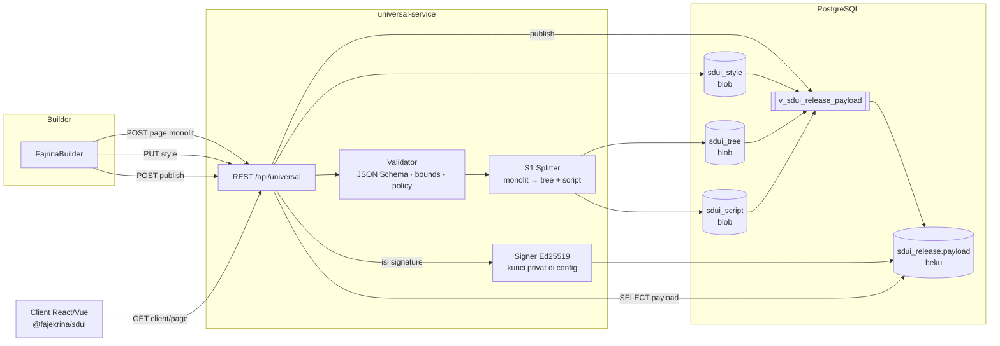
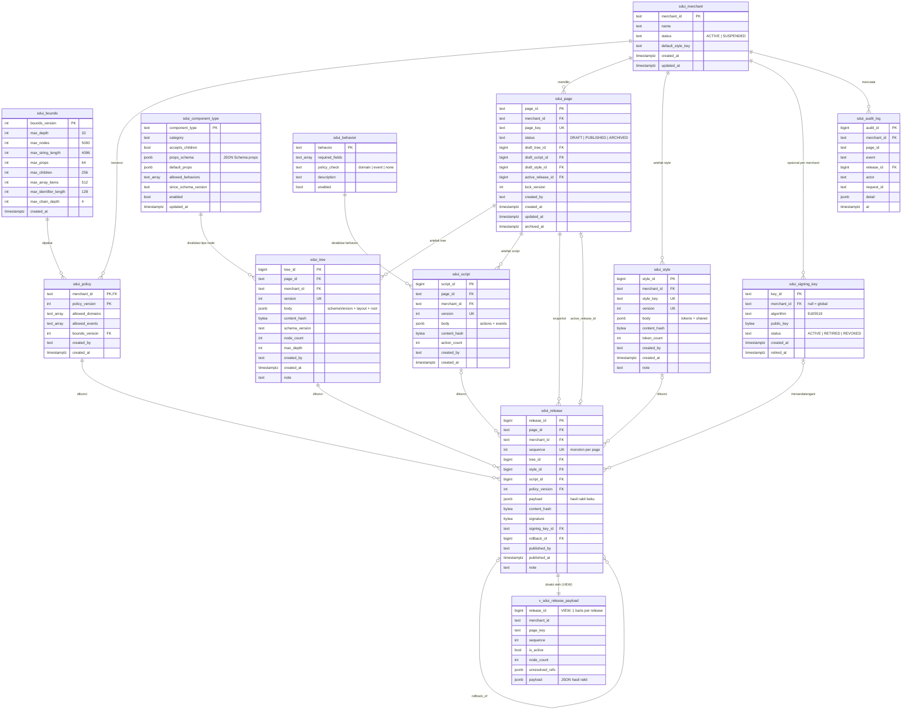

# Desain Sistem SDUI: 3 Artefak Blob JSON + View Hasil Rakit

> Status: desain siap implementasi · Tanggal: 2026-11-10
> Target database: PostgreSQL 14+ (jsonb). Dokumen ini berisi desain + ERD + kamus data; DDL ditulis saat implementasi.
> Menggantikan bagian penyimpanan di `ARSITEKTUR-SDUI-SPLIT.md §4/§8` dan merapikan inkonsistensi di `SPLIT-RAKIT-CLIENT-VS-SERVER.md`.
> Keputusan yang dipertahankan: **S1 + A1** (server membelah saat simpan, server merakit saat baca), release atomik + sequence monoton.

---

## 1. Ringkasan keputusan

| # | Keputusan | Alasan |
|---|---|---|
| 1 | Satu page disimpan sebagai **3 artefak blob jsonb**: **style**, **tree**, **script** | Sesuai rencana split; sederhana; siap dikirim apa adanya bila A2 diaktifkan |
| 2 | Artefak **immutable + berversi**; simpan yang isinya sama tidak membuat versi baru (dibandingkan lewat `content_hash`) | Release lama tidak bisa berubah; tidak ada versi sampah |
| 3 | Style dimiliki **merchant** (dipakai banyak page); tree dan script dimiliki **page** | Ganti brand sekali untuk semua page; struktur & aksi spesifik per halaman |
| 4 | Tree disimpan **bersarang saja** (`children`), tanpa `parentId/order` | Satu representasi (P0 `PAYLOAD-RAMPING-SDUI.md`); `parentId/order` diturunkan saat rakit |
| 5 | **Satu view** `v_sdui_release_payload` = satu-satunya logika rakit JSON | Satu sumber kebenaran untuk publish, preview, diff |
| 6 | Hasil view **dibekukan** ke `sdui_release.payload` saat publish | Baca produksi O(1); perubahan resolver tidak diam-diam mengubah release lama |
| 7 | Aturan yang hari ini hardcode (tipe komponen, behavior, bounds) jadi **data berversi** | Satu sumber untuk builder, backend, dan library |

Kenapa blob dan bukan per komponen: dengan S1 + A1 builder selalu mengirim halaman utuh dan client selalu menerima bundle, jadi keunggulan per komponen (edit granular, gabung edit bersamaan) belum terpakai, sementara biayanya (diff per node, versi temporal, validasi pohon di aplikasi) tetap harus dibayar. Halaman saat ini kecil (7–15 KB, 10–26 node). Kapan beralih: lihat §11.

## 2. Gambaran sistem



Library client **tidak berubah**: tetap menerima bundle flat `parentId + order`, lalu menjalankan preset bawaan, validasi, dan render di core.

## 3. Bentuk 3 artefak

Contoh dari `merchant_demo/home` (26 node), dipotong.

### 3.1 Style: `sdui_style.body` (milik merchant)

```json
{
  "tokens": {
    "color":  { "brand.primary": "#6c8cff", "ink.heading": "#0f172a", "ink.body": "#475569" },
    "radius": { "brand.md": "12px" }
  },
  "shared": {
    "cardEvent":  { "display": "flex", "flexDirection": "column", "gap": "12px", "padding": "16px",
                    "backgroundColor": "#ffffff", "border": "1px solid #e2e8f0", "borderRadius": "12px" },
    "btnOutline": { "backgroundColor": "#ffffff", "color": "#6c8cff", "border": "1px solid #6c8cff",
                    "borderRadius": "8px", "fontSize": "14px", "fontWeight": "600" }
  }
}
```

- Kategori token: `color / space / radius / font / shadow`. Nama token unik **lintas kategori** dalam satu style (node merujuk nama saja: `brand.primary`).
- Namespace `sdui.*` dicadangkan untuk token bawaan library.

### 3.2 Tree: `sdui_tree.body` (milik page)

```json
{
  "schemaVersion": "1.0",
  "layout": { "type": "Container", "title": null, "subtitle": null },
  "root": {
    "id": "01HQ0000000000000000000001", "type": "Container", "props": { "as": "div" },
    "style": { "display": "flex", "flexDirection": "column", "gap": "24px", "padding": "24px" },
    "children": [
      { "id": "01HQ0000000000000000000002", "type": "Container", "props": { "as": "div" },
        "children": [
          { "id": "01HQ0000000000000000000005", "type": "Button",
            "props": { "label": "Pilih Kursi Sekarang", "type": "button" },
            "style": { "backgroundColor": "#6c8cff", "color": "#ffffff", "borderRadius": "8px" },
            "actionRef": "a_1c0e5f9b2d41" } ] },
      { "id": "01HQ0000000000000000000007", "type": "Container", "sharedStyle": "cardEvent",
        "children": [
          { "id": "01HQ0000000000000000000011", "type": "Button", "sharedStyle": "btnOutline",
            "token": { "color": "brand.primary" },
            "props": { "label": "Lihat Detail", "type": "button" }, "actionRef": "a_7f30c2e19a08" } ] }
    ]
  }
}
```

Kunci per node: `id` (ULID), `type`, `props` (**tanpa** `action`), `style?` (inline, menang), `token?` (`{cssProp: "nama.token"}`), `sharedStyle?`, `actionRef?`, `children?`.

### 3.3 Script: `sdui_script.body` (milik page)

```json
{
  "actions": {
    "a_1c0e5f9b2d41": { "behavior": "navigate", "target": "seat-selection", "params": {} },
    "a_7f30c2e19a08": { "behavior": "navigate", "target": "seat-selection",
                        "params": { "eventId": "event-jazz-01" } }
  },
  "events": []
}
```

- `actions`: kosakata tertutup (`behavior` harus ada di `sdui_behavior`). Nama dari S1 = `a_` + 12 hex `sha256(aksi kanonik)`: deterministik, aksi identik = nama sama. Builder boleh memberi nama sendiri (`goSeatSelection`).
- `events`: event `customEvent` yang dipancarkan page; harus ⊆ `policy.allowed_events`.
- Validasi field form tetap di `props` komponen (`required`, `minLength`, `validation`), tidak dipindah ke script.

## 4. Skema database

### 4.1 ERD



### 4.2 Kamus data

Konvensi: `PK` primary key, `FK` foreign key, `UK` unique, `NN` not null. Waktu selalu `timestamptz`.

#### `sdui_merchant`: tenant
| Kolom | Tipe | Aturan | Keterangan |
|---|---|---|---|
| merchant_id | text | PK, `^[a-z0-9_]{3,64}$` | `merchant_demo` |
| name | text | NN | nama tampilan |
| status | text | NN, `ACTIVE`/`SUSPENDED` | SUSPENDED = endpoint client 404 |
| default_style_key | text | null | style default untuk page baru |
| created_at / updated_at | timestamptz | NN | |

#### `sdui_bounds`: batas validasi berversi (menggantikan `DEFAULT_BOUNDS` di 3 tempat)
| Kolom | Tipe | Aturan | Default hari ini |
|---|---|---|---|
| bounds_version | int | PK | 1 |
| max_depth | int | NN, > 0 | 32 |
| max_nodes | int | NN | 5000 |
| max_string_length | int | NN | 4096 |
| max_props | int | NN | 64 |
| max_children | int | NN | 256 |
| max_array_items | int | NN | 512 |
| max_identifier_length | int | NN | 128 |
| max_chain_depth | int | NN | 4 |
| created_at | timestamptz | NN | |

Immutable; batas baru = versi baru, dirujuk policy.

#### `sdui_policy`: izin per merchant, berversi
| Kolom | Tipe | Aturan | Keterangan |
|---|---|---|---|
| merchant_id | text | PK, FK merchant | |
| policy_version | int | PK, > 0 | ditampilkan sebagai string `"1"` di payload |
| allowed_domains | text[] | NN, default `{}` | untuk `externalLink`, `Link.href`, `Image.src` |
| allowed_events | text[] | NN, default `{}` | untuk `customEvent` |
| bounds_version | int | FK bounds, NN | batas yang berlaku |
| created_by / created_at | text / timestamptz | NN | |

Immutable; versi baru = baris baru. Publish selalu memakai versi terbaru.

#### `sdui_component_type`: registry tipe (menggantikan enum di schema JSON, service, dan TS)
| Kolom | Tipe | Aturan | Keterangan |
|---|---|---|---|
| component_type | text | PK, `^[A-Z][A-Za-z0-9]{1,31}$` | 18 tipe: Button, Card, Container, … |
| category | text | NN, `layout/content/form/navigation/feedback` | pengelompokan palette builder |
| accepts_children | bool | NN | false → node tipe ini tidak boleh punya `children` |
| props_schema | jsonb | NN | JSON Schema props; memuat aturan Grid 1–12, enum Flex direction/justify |
| default_props | jsonb | NN | nilai awal saat drag ke kanvas |
| allowed_behaviors | text[] | NN | mis. Button: navigate, submit, back, …; Image: kosong |
| since_schema_version | text | NN | tipe muncul sejak schemaVersion berapa |
| enabled | bool | NN | false = hilang dari palette, tetap bisa dirender |
| updated_at | timestamptz | NN | |

#### `sdui_behavior`: kosakata aksi tertutup
| Kolom | Tipe | Aturan | Keterangan |
|---|---|---|---|
| behavior | text | PK | navigate, back, submit, externalLink, openModal, closeModal, toast, customEvent |
| required_fields | text[] | NN | navigate: `{target}`, externalLink: `{href}`, toast: `{message}` |
| policy_check | text | NN, `domain/event/none` | externalLink → domain, customEvent → event |
| description | text | NN | |
| enabled | bool | NN | |

#### `sdui_page`: satu-satunya entitas mutable (pointer)
| Kolom | Tipe | Aturan | Keterangan |
|---|---|---|---|
| page_id | text | PK | `merchant_demo-home` |
| merchant_id | text | FK, NN | |
| page_key | text | NN, UK(merchant_id, page_key), `^[a-z0-9][a-z0-9-]{0,63}$` | |
| status | text | NN, `DRAFT/PUBLISHED/ARCHIVED` | |
| draft_tree_id | bigint | FK tree (page sama), null | versi tree yang sedang diedit |
| draft_script_id | bigint | FK script (page sama), null | |
| draft_style_id | bigint | FK style (merchant sama), null | null = tanpa style bersama (hanya inline + preset) |
| active_release_id | bigint | FK release (page sama), null | yang dilayani ke client |
| lock_version | int | NN | optimistic locking builder |
| created_by / created_at / updated_at | | NN | |
| archived_at | timestamptz | null | |

#### `sdui_style`: artefak style (blob, milik merchant)
| Kolom | Tipe | Aturan | Keterangan |
|---|---|---|---|
| style_id | bigint | PK identity | |
| merchant_id | text | FK, NN | style tidak bisa dipakai lintas merchant |
| style_key | text | NN, `^[a-z0-9][a-z0-9-]{0,63}$` | `brand-default` |
| version | int | NN, UK(merchant_id, style_key, version) | API menampilkan `brand-default@3` |
| body | jsonb | NN, lolos JSON Schema style (§3.1) | `{tokens, shared}` |
| content_hash | bytea | NN, 32 byte, UK(merchant_id, style_key, content_hash) | `sha256(body::text)`; isi sama = tidak ada versi baru |
| token_count | int | NN | diisi aplikasi, untuk daftar di builder |
| created_by / created_at | | NN | |
| note | text | null | pesan simpan |

#### `sdui_tree`: artefak tree (blob, milik page)
| Kolom | Tipe | Aturan | Keterangan |
|---|---|---|---|
| tree_id | bigint | PK identity | |
| page_id | text | FK page, NN | |
| merchant_id | text | FK, NN | duplikasi sengaja untuk FK komposit tenant |
| version | int | NN, UK(page_id, version), monoton | API menampilkan `home@16` |
| body | jsonb | NN, lolos JSON Schema tree (§3.2) | `{schemaVersion, layout, root}` |
| content_hash | bytea | NN, 32 byte, UK(page_id, content_hash) | isi sama = tidak ada versi baru |
| schema_version | text | NN, = `body->>'schemaVersion'` | diangkat ke kolom untuk filter/kompatibilitas |
| node_count | int | NN, ≤ `bounds.max_nodes` | diisi validator |
| max_depth | int | NN, ≤ `bounds.max_depth` | diisi validator |
| created_by / created_at | | NN | |
| note | text | null | pesan simpan dari builder |

Index: GIN `jsonb_path_ops` pada `body` untuk query lintas halaman (mis. node bertipe Button dengan `actionRef` tertentu).

#### `sdui_script`: artefak script (blob, milik page)
| Kolom | Tipe | Aturan | Keterangan |
|---|---|---|---|
| script_id | bigint | PK identity | |
| page_id | text | FK page, NN | |
| merchant_id | text | FK, NN | |
| version | int | NN, UK(page_id, version), monoton | API menampilkan `home-logic@6` |
| body | jsonb | NN, lolos JSON Schema script (§3.3) | `{actions, events}` |
| content_hash | bytea | NN, 32 byte, UK(page_id, content_hash) | |
| action_count | int | NN | |
| created_by / created_at | | NN | |

Index: GIN pada `body`.

#### `sdui_signing_key`: registry kunci publik
| Kolom | Tipe | Aturan | Keterangan |
|---|---|---|---|
| key_id | text | PK | dikirim di envelope agar client tahu kunci mana |
| merchant_id | text | FK, null | null = kunci global |
| algorithm | text | NN, `Ed25519` | |
| public_key | bytea | NN | kunci **privat tetap di config/secret manager**, tidak pernah di DB |
| status | text | NN, `ACTIVE/RETIRED/REVOKED` | REVOKED = release bertanda tangan kunci ini dianggap tidak sah |
| created_at / retired_at | timestamptz | | rotasi kunci |

#### `sdui_release`: snapshot atomik
| Kolom | Tipe | Aturan | Keterangan |
|---|---|---|---|
| release_id | bigint | PK identity | |
| page_id / merchant_id | text | FK page (komposit), NN | |
| sequence | int | NN, UK(page_id, sequence), monoton | anti-downgrade |
| tree_id | bigint | NN, FK tree (page sama) | |
| style_id | bigint | FK style (merchant sama), null | |
| script_id | bigint | FK script (page sama), null | |
| policy_version | int | NN, FK policy (merchant sama) | |
| payload | jsonb | diisi sekali saat publish | hasil view yang dibekukan |
| content_hash | bytea | 32 byte, diisi sekali | `sha256(payload::text)`, dipakai juga sebagai ETag |
| signature | bytea | null, diisi sekali oleh aplikasi | Ed25519 atas content_hash |
| signing_key_id | text | FK signing_key, null | |
| rollback_of | bigint | FK release, null | |
| published_by / published_at | | NN | |
| note | text | null | |

Tidak bisa DELETE; UPDATE hanya mengisi kolom yang masih NULL (payload/hash, lalu signature + key).

#### `sdui_audit_log`: append-only
| Kolom | Tipe | Aturan | Keterangan |
|---|---|---|---|
| audit_id | bigint | PK identity | |
| merchant_id | text | FK, NN | |
| page_id | text | null | |
| event | text | NN | `SAVE_DRAFT, PUBLISH, ROLLBACK, ARCHIVE, SIGN, STYLE_SAVE, POLICY_SAVE` |
| release_id | bigint | FK, null | |
| actor | text | NN | id user dari sistem auth |
| request_id | text | null | korelasi dengan log aplikasi |
| detail | jsonb | NN | mis. `{tree: "home@16", script: "home-logic@6", unchanged: ["script"]}` |
| at | timestamptz | NN | index `(page_id, at DESC)` |

### 4.3 Integritas

- **Antar-tenant**: FK komposit `(…_id, merchant_id)` / `(…_id, page_id)`. Page hanya bisa menunjuk tree/script miliknya sendiri dan style milik merchant-nya; release hanya bisa mengunci artefak + policy milik page/merchant yang sama. Visual spoofing antar merchant tercegah tanpa bergantung pada kode aplikasi.
- **Immutability** (trigger): UPDATE ke `sdui_style / sdui_tree / sdui_script / sdui_policy / sdui_bounds` ditolak; edit = INSERT versi baru. DELETE artefak hanya bila tidak dirujuk release mana pun (FK `RESTRICT`).
- **Validasi isi blob** (aplikasi, sebelum INSERT): JSON Schema per jenis artefak; tipe node ∈ `sdui_component_type` (enabled atau sudah dipakai sebelumnya); `props` lolos `props_schema`; node tanpa `accepts_children` tidak punya `children`; `id` unik dalam tree; bounds; `behavior` ∈ `sdui_behavior` dan ∈ `allowed_behaviors` tipe node; domain/event vs policy.

## 5. View hasil rakit: `v_sdui_release_payload`

Satu baris per release.

| Kolom | Arti |
|---|---|
| `release_id`, `merchant_id`, `page_key`, `sequence` | identitas |
| `is_active` | `page.active_release_id = release_id` |
| `node_count` | jumlah node hasil flatten |
| `unresolved_refs` | `[{node, token}]`, `[{node, sharedStyle}]`, `[{node, actionRef}]` yang tidak ketemu |
| `payload` | JSON siap kirim (bentuk A1, flat) |

Langkah perakitan (join `release → tree.body, style.body, script.body, policy`):

1. **Flatten tree**: rekursif dari `root` lewat `children` (`jsonb_array_elements WITH ORDINALITY`). Tiap node mendapat `parentId` = id induk dan `order` = nomor urut **pre-order** mulai 0. Hasilnya sama dengan `order` di file sumber hari ini.
2. **Style**: `style.body.shared[sharedStyle]` → token (`token[cssProp]` dicari di semua kategori `style.body.tokens`) → `style` inline. Digabung berurutan sehingga yang menang: **inline > token > shared**. Preset bawaan per tipe **tidak** diterapkan di DB; tetap tugas resolver core library agar React/Vue identik.
3. **Aksi**: `props || {"action": script.body.actions[actionRef]}` bila `actionRef` ada.
4. **Urutan output**: `ORDER BY order`; komponen flat `{id, component, parentId, order, props, style?}`; kunci `token / sharedStyle / actionRef / children` tidak dikirim.
5. **Envelope**: `pageId, pageKey, merchantId, status, schemaVersion, version, releaseSequence, publishedAt, policy{merchantId, policyVersion, allowedDomains, allowedEvents}, layout{type, title?, subtitle?, components[]}`. `schemaVersion` dan `layout` diambil dari **tree yang dikunci release**, bukan dari draft.

Pemetaan node tree → JSON komponen:

| Tree (`sdui_tree.body`) | Payload A1 |
|---|---|
| `id` | `id` |
| `type` | `component` |
| posisi di `children` induk | `parentId` |
| nomor pre-order | `order` |
| `props` + `script.actions[actionRef]` | `props` (dengan `props.action`) |
| `sharedStyle` + `token` + `style` | `style` (hasil gabung) |

Contoh keluaran (dipotong):

```json
{
  "pageId": "merchant_demo-home", "pageKey": "home", "merchantId": "merchant_demo",
  "status": "PUBLISHED", "schemaVersion": "1.0", "version": 43, "releaseSequence": 43,
  "policy": { "merchantId": "merchant_demo", "policyVersion": "1",
              "allowedDomains": ["example.com", "cdn.example.com"], "allowedEvents": [] },
  "layout": { "type": "Container", "components": [
    { "id": "01HQ0000000000000000000011", "component": "Button",
      "parentId": "01HQ0000000000000000000007", "order": 10,
      "props": { "label": "Lihat Detail", "type": "button",
                 "action": { "behavior": "navigate", "target": "seat-selection",
                             "params": { "eventId": "event-jazz-01" } } },
      "style": { "backgroundColor": "#ffffff", "color": "#6c8cff", "border": "1px solid #6c8cff",
                 "borderRadius": "8px", "fontSize": "14px", "fontWeight": "600" } }
  ] }
}
```

Kapan memakai view vs kolom beku:
- `sdui_release.payload`: endpoint client (produksi), ETag, signing.
- `v_sdui_release_payload`: saat publish (terfilter satu `release_id`), preview/diff di tabel release builder, dan audit "apa hasil resolver hari ini" dibanding yang dibekukan. Selalu filter `release_id` atau `merchant_id + page_key`.

## 6. Alur data

### 6.1 Simpan draft (S1): satu transaksi

1. Terima monolit flat (format hari ini: `components[]` dengan `parentId + order + props.action`).
2. Validasi: skema, bounds, `props_schema`, aksi & domain vs policy. Gagal → 422 dengan daftar error per node.
3. **Belah** (deterministik dan lossless):
   - susun pohon bersarang dari `parentId`, urutkan anak berdasarkan `order`;
   - keluarkan `props.action` → `script.actions["a_" + 12 hex sha256(aksi kanonik)]`, node diberi `actionRef`;
   - `style` inline, `token`, `sharedStyle` dibiarkan apa adanya (tokenisasi = aksi eksplisit di editor, bukan efek samping simpan).
4. Hitung `content_hash` tree dan script. Bila sama dengan versi draft saat ini → tidak membuat versi baru untuk artefak itu.
5. INSERT artefak yang berubah (`version = max + 1`).
6. `UPDATE sdui_page SET draft_tree_id, draft_script_id, lock_version = lock_version + 1 WHERE page_id = :id AND lock_version = :expected` (0 baris → 409 Conflict).
7. INSERT `sdui_audit_log (SAVE_DRAFT)`.

Simpan style terpisah: `PUT styles/{styleKey}` → validasi → INSERT versi baru bila hash berbeda → audit `STYLE_SAVE`. Page memilih style lewat `draft_style_id`.

### 6.2 Publish

Satu transaksi:
1. Kunci page (`FOR UPDATE`) → publish paralel di page yang sama terserialisasi.
2. `sequence = max + 1`; kunci `draft_tree_id / draft_script_id / draft_style_id`; `policy_version` = terbaru.
3. INSERT release → rakit lewat view → **tolak** bila `unresolved_refs` tidak kosong (fail-closed saat publish, fail-soft saat render).
4. Bekukan `payload` + `content_hash`; pindahkan `active_release_id`; status `PUBLISHED`; audit.
5. Setelah commit, aplikasi menandatangani `content_hash` lalu mengisi `signature` + `signing_key_id` (audit `SIGN`).

### 6.3 Rollback

Release **baru** dengan `tree_id / style_id / script_id` milik release lama, policy terbaru, `rollback_of` = release asal. Sequence tetap naik (anti-downgrade), dan pencabutan izin domain tidak ikut dibatalkan. Draft tidak berubah.

### 6.4 Baca (A1)

```sql
SELECT r.payload, encode(r.content_hash, 'hex') AS etag, r.signature, r.signing_key_id
FROM sdui_page p
JOIN sdui_release r ON r.release_id = p.active_release_id
WHERE p.merchant_id = $1 AND p.page_key = $2;
```

`ETag = content_hash` → `If-None-Match` → 304 tanpa body. Release immutable, jadi cache HTTP boleh lama.

### 6.5 A2 nanti (tanpa ubah skema)

`GET client/manifest/{mid}/{key}` = refs + hash dari release aktif; `GET artifacts/{styles|trees|scripts}/{id}/{version}` = `body` apa adanya, `ETag = content_hash`, cache immutable. Client merakit dengan resolver core yang sama dengan view.

## 7. Pemetaan API

| Endpoint | Operasi |
|---|---|
| `POST /api/universal/merchant/pages/{mid}/{key}` | §6.1 → `{ tree: "home@16", script: "home-logic@6", unchanged: [] }` |
| `GET …/pages/{mid}/{key}/trees` | daftar versi tree (tanpa body) |
| `GET …/pages/{mid}/{key}/trees/{version}` | body tree versi tertentu (diff di builder) |
| `POST …/pages/{mid}/{key}/publish` | §6.2 → `{ releaseId, sequence, contentHash }` |
| `POST …/pages/{mid}/{key}/rollback?to={seq}` | §6.3 |
| `GET /api/universal/merchant/releases/{mid}/{key}` | daftar dari view (tanpa kolom payload) urut `sequence DESC` |
| `PUT /api/universal/merchant/styles/{styleKey}` | INSERT versi style baru |
| `GET /api/universal/merchant/component-types` | palette builder dari `sdui_component_type` |
| `GET /api/universal/client/page/{mid}/{key}` | §6.4; kontrak respons sama seperti hari ini + `releaseSequence` |
| `GET /api/universal/client/signing-keys` | kunci publik `ACTIVE`/`RETIRED` |

## 8. Penyesuaian terhadap rencana sebelumnya (best practice)

1. **Tree hanya bersarang**: `parentId/order` tidak disimpan, diturunkan saat rakit (pre-order). Menghapus duplikasi dua representasi (P0).
2. **Dedup lewat `content_hash`**: simpan tanpa perubahan tidak membuat versi baru; style/script yang tidak berubah tidak ikut naik versi.
3. **Pemilik artefak dipertegas**: style milik merchant (dipakai bersama), tree dan script milik page. Rencana lama tidak menyebut pemilik, sehingga style bisa dirujuk lintas merchant.
4. **Payload dibekukan saat publish**: perbaikan bug resolver tidak diam-diam mengubah release lama atau membatalkan signature.
5. **Splitter deterministik dan lossless**: rencana lama ("token dibuat otomatis dari nilai berulang, style yang sama dengan preset dibuang") bersifat heuristik, nama token tidak stabil, dan preset bisa berubah antar versi library. Memindah nilai ke token/shared style menjadi aksi eksplisit di editor.
6. **Validasi form tetap di props**, bukan di `script.validations`: aturan field berada di samping field-nya; script hanya berisi aksi + event.
7. **Nama token unik lintas kategori** dalam satu style, karena node merujuk nama tanpa kategori.
8. **Aturan menang satu kalimat**: inline > token > shared style (DB) > preset (library). "Tema" = artefak style; tidak ada tabel THEME terpisah.
9. **`policy_version` dikunci di release**; `published_by` + `sdui_audit_log` menggantikan kolom `actor` di view.
10. **Rollback memakai policy terbaru**: konten dikembalikan, pencabutan izin keamanan tidak.
11. **ID surrogate `bigint identity`**; string `brand-default@3` hanya representasi di API.
12. **Publish fail-closed, render fail-soft**: ref tak dikenal ditolak saat publish sehingga Null-Object di client hanya jaring pengaman.
13. **Immutability ditegakkan DB** (trigger), bukan konvensi.
14. **Hardcode jadi data**: tipe komponen, behavior, dan bounds menjadi tabel; kunci publik signing jadi registry dengan status rotasi.
15. **Konsistensi nomor contoh**: dengan S1 + A1 release `merchant_demo/home` berikutnya adalah #43 (bukan #44 dari skenario S2). Perbaiki `SPLIT-RAKIT-CLIENT-VS-SERVER.md §A1` saat dokumen itu disentuh lagi.

## 9. Migrasi dari file-based

1. Tambah dependensi `universal-service`: `spring-boot-starter-jdbc`, `org.postgresql:postgresql`, `org.flywaydb:flyway-core` + `flyway-database-postgresql`.
2. Migrasi DDL pertama (Flyway) dari ERD §4, termasuk seed: 18 tipe komponen (props_schema dari `universal-components.json`), 8 behavior, bounds v1.
3. Importer satu kali: `data/universal/policies/*.json` → `sdui_merchant` + `sdui_policy`; tiap `pages/{mid}/{key}.json` → simpan (§6.1, tree v1 + script v1) → publish bila `status = PUBLISHED`.
4. Mode bayangan: baca file dan DB berdampingan, bandingkan payload (kanonik) di log; setelah nol selisih, matikan jalur file.
5. Builder membaca palette dari `sdui_component_type`; backend memvalidasi terhadapnya.

## 10. Kriteria uji saat implementasi

| Uji | Harapan |
|---|---|
| Impor → publish → view untuk checkout (10), home (26), seat-selection (17) | komponen identik dengan file sumber, termasuk `parentId` dan `order` |
| Payload beku == view, `content_hash` 32 byte | sama |
| Simpan tanpa perubahan | tidak ada versi tree/script baru |
| Ubah 1 label | tree versi baru; script tetap versi lama |
| Ubah 1 target aksi | script versi baru; tree tetap bila nama aksi buatan builder |
| Resolusi style | shared < token < inline |
| Token / sharedStyle / actionRef tak dikenal saat publish | ditolak |
| `behavior` di luar `sdui_behavior` atau di luar `allowed_behaviors` tipe | ditolak saat simpan |
| Page menunjuk style merchant lain | ditolak (FK komposit) |
| UPDATE artefak / release, DELETE release, tanda tangan ulang | ditolak |
| Rollback ke #1 | release baru dengan sequence naik, isi == release #1 |
| Simpan bersamaan dengan `lock_version` lama | 409 Conflict |

## 11. Risiko, batasan, dan kapan beralih ke per komponen

- **Ubah 1 label = tree versi baru penuh**. Untuk halaman 7–15 KB biayanya diabaikan; pantau ukuran tree terbesar.
- **Riwayat per komponen** harus dihitung dengan diff dua versi tree (berdasarkan `id` node), bukan query langsung.
- **Query lintas halaman** memakai `jsonb_path_query` + index GIN; cukup untuk pencarian, kurang nyaman untuk laporan berat.
- **Urutan kunci JSON** di payload mengikuti jsonb (bukan urutan input). Secara semantik sama; signature dihitung atas teks jsonb yang dibekukan, jadi verifikasi tetap konsisten.
- Preset per tipe tetap di library: perubahan preset di versi library baru masih bisa mengubah tampilan, sama seperti hari ini. Mitigasinya snapshot test React-vs-Vue (Fase 0 migrasi).

Beralih ke penyimpanan per komponen bila salah satu terjadi:
- builder mulai menyimpan per komponen atau dipakai kolaboratif (edit bersamaan di page yang sama);
- ada komponen global yang dipakai ulang di banyak halaman;
- audit/laporan per komponen menjadi kewajiban;
- halaman tumbuh sampai ribuan node.

Karena setiap node di blob sudah punya `id` (ULID) tetap, peralihan cukup berupa migrasi data (urai blob → record), tanpa mengubah kontrak API.
