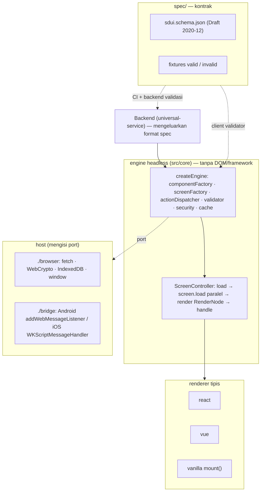
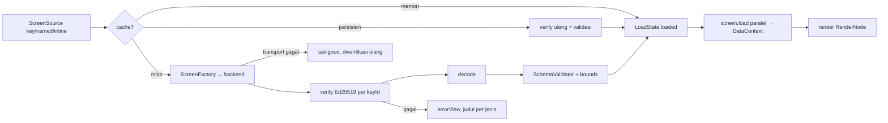

# HANDOFF — @fajekrina/sdui (library)

> Tanggal: 2026-11-11 · Versi: **0.4.0** (BREAKING; belum di-commit, belum di-publish)
> Acuan: **"Usulan Arsitektur SDUI: Selaras dengan Murti"** (`../Usulan Arsitektur SDUI Selaras dengan Murti.md`)
> Spec: `spec/` · Host: `HOST-BRIDGE.md` · Riwayat: `CHANGELOG.md` · Atribusi: `NOTICE`
> Belum disesuaikan (sengaja, menyusul): `universal-service`, `react-tailwind`, `vue-bootstrap` — lihat §7.

## 1. Apa ini
**Library**, bukan framework: aplikasi (web, atau host Android/iOS lewat WebView) yang memanggil sdui dan
tetap memegang router, state, dan auth. Yang diadopsi dari framework hanya arsitekturnya: **satu spec, satu
engine headless, renderer tipis, host mengisi port.** Kontrak payload = spec milik kita di `spec/`, turunan
murti v1 + tambahan v1.1 yang aditif. murti hanya acuan format dan desain, bukan dependensi.

## 2. Desain sistem

### 2.1 Empat lapis


### 2.2 Pipeline load (fail-closed)


### 2.3 Alur aksi
Klik → `RenderNode.on.click` → `screen.handle(key)` → (di dalam `form`: validasi field dengan pola bernama; gagal =
error per field + event `form_invalid`) → `ActionDispatcher` → Command tertutup:
`navigate` (Navigator, `presentation`), `api` (NetworkClient + NamedRequest, hasil di-merge ke data), `dismiss`,
`refresh` (muat ulang layar), `openURL` (nama link), `toast` (UI store), `native` (HostPort). Rantai `onSuccess`/`onError`
≤ 4. Params `{{token}}` di-resolve saat dispatch.

### 2.4 Kontrak data
- Payload `{ schemaVersion, screen: { key, load?, root, variants? } }`; envelope `{ schemaVersion, alg, keyId?, payload(b64), signature(b64) }`.
- Node `{ type, id?, props?, children?, action? }`; 16 komponen bawaan; style tertutup + token warna; `systemName`.
- RenderNode `{ key, type?, element, attrs, style, text?, field?, on?, slot?, children }` — satu-satunya input renderer.
- Event observabilitas `SduiEvent` (tanpa PII).

## 3. Status (0.4.0)

| Item usulan | Status | Di mana |
| --- | --- | --- |
| Spec milik sendiri + fixture + lint (Ajv) | ✅ | `spec/`, `tests/spec.test.ts` |
| Engine berstruktur MurtiEngine | ✅ | `src/core/engine.ts`, `screen.ts` |
| Renderer generik React/Vue/vanilla + paritas | ✅ | `src/react`, `src/vue`, `src/vanilla`, `tests/parity.test.tsx` |
| Null Object (marker hanya debug) + event `unknown_component` | ✅ | `render-context.ts` |
| Aksi tertutup + target bernama (+ toast, native, presentation) | ✅ | `actions/` |
| Style terbatas + token tema semantik | ✅ | `style.ts`, `bridge.applyTheme` |
| `DataContext` + `{{token}}` | ✅ | `data-context.ts`, `token.ts` |
| `screen.load` paralel + skeleton + `maxLoadRequests` | ✅ | `screen.ts` |
| Form + pola bernama + `secure` | ✅ | `components/builtins.ts`, `patterns.ts` |
| Komponen layout v1.1 (spacer, divider, grid, list, scroll) | ✅ | `components/builtins.ts` |
| Varian compact/wide | ✅ | `screen.ts` (`ViewportPort`) |
| Envelope Ed25519 + `keyId` + verifikasi tiap load (termasuk cache) | ✅ | `engine.ts`, `browser.webCryptoEd25519`, `keyedVerifier` |
| Cache memori/IndexedDB + AES-GCM + manifest `sequence` anti-rollback | ✅ | `cache/`, `browser` |
| Native bridge + token pola B | ✅ (sisi web) | `src/bridge`, `HOST-BRIDGE.md` |
| Manifest bundle bertanda tangan | ✅ (tooling + verifikasi referensi) | `scripts/sign-bundle.mjs`, `bridge/bundle-manifest.ts` |
| Observabilitas `onEvent` | ✅ | `events.ts` |
| DSL TS + DSLExport lossless | ✅ | `builder/dsl.ts`, `dsl-export.ts` |
| Builder = Studio (pratinjau == client, ekspor tervalidasi) | ✅ | `builder/studio.ts` (+ wrapper React/Vue) |
| `fromUniversal` (alat builder) | ✅ | `src/compat` |
| Gerbang CI: `npm ci`, typecheck, tes, kemurnian core, budget, conformance | ✅ | `.github/workflows/ci.yml` |
| Conformance Chromium ≡ WebKit | ⚠ harness ✅, WebKit hanya di CI | Windows lokal tak punya DLL WebKit; `CONFORMANCE_PAIR=chromium,chromium` untuk smoke lokal |
| Aplikasi host Android/iOS | ⏳ | di luar repo ini; kontrak di `HOST-BRIDGE.md` |
| Versi minimum WebView/iOS dari data distribusi | ⏳ | butir terbuka usulan |

Angka saat ini: **164 tes / 11 file** lulus; typecheck src + tests bersih; build bersih;
ukuran (esbuild, minify, gzip): core 16,5 KB, react 1,3, vue 1,2, vanilla 1,3, browser 2,4, bridge 2,7.

### Deviasi yang disengaja
- **Validator lapis 2 di client ditulis tangan** (port `MurtiSchemaValidator`), bukan Ajv di runtime: Ajv ±35 KB
  akan melanggar budget bundle. Ajv dipakai di CI (`tests/spec.test.ts`) dan oleh backend; tes memastikan keduanya sepakat.
  Key struktural asing diabaikan client (kebijakan minor forward-compat) — empat fixture invalid ditolak hanya di lapis skema.
- **Tipe TS ditulis tangan**, bukan dibangkitkan `json-schema-to-typescript`; kelas model (`SduiNode`, `ActionSpec`, …) punya
  decode/encode sendiri yang diuji terhadap fixture.
- **`zstack` absolut** memakai persentase (proporsional), bukan `scaleEffect` — teks tidak ikut diskalakan.
- **Cache key** `sdui:<screen>@<version>` tanpa SHA-256 (core tak boleh menyentuh `crypto`; IndexedDB tak butuh nama file aman).

## 4. Peta kode
```
spec/                 sdui.schema.json, fixtures/, README.md (kontrak)
src/spec/             SPEC_VERSION, daftar komponen
src/core/             engine (murni) — value, node, payload, bounds, validator, token, data-context, patterns,
                      style, components/, component-factory, render-context, render-node, screen-factory,
                      actions/ (spec, dispatcher), security, cache/, engine, screen, events, ui-store
src/ports/            kontrak port + default aman
src/browser/          port browser (fetch, WebCrypto, IndexedDB, AES-GCM, navigator, viewport)
src/bridge/           protokol host, nativeBridgePorts, applyTheme, verifyBundleManifest
src/react|vue|vanilla renderer generik
src/builder/          EditorDocument, tree ops, DSL, DSLExport, preview, Studio (DOM) + wrapper React/Vue
src/compat/           fromUniversal
conformance/          harness Playwright Chromium ≡ WebKit
scripts/              size.mjs (budget), sign-bundle.mjs
tests/                vitest (fixtures/legacy = halaman Universal lama untuk compat)
```

## 5. Kontrak penting
- Payload **tidak pernah** berisi URL mentah atau regex: request/link/command = nama; pola field = nama.
- Endpoint = konfigurasi bundle (`fetchNetworkClient({ endpoints })`); nama tak dikenal gagal tertutup.
- Token API pola B (`getHeaders({ refresh })`), hanya di memori; 401 → satu kali refresh.
- `secure` field tidak masuk data layar, log, maupun cache. Respons `api` tidak pernah di-cache.
- `load()` tidak pernah throw; kegagalan = `errorView` (judul per jenis error, detail hanya `debug`).
- Last-good offline hanya untuk kegagalan transport (offline/5xx); payload baru yang gagal verifikasi tidak ditutupi.

## 6. Cara kerja
```bash
npm ci                     # repo ini berdiri sendiri; lockfile sudah diperbarui & npm ci terverifikasi
npm run typecheck
npm test                   # 164 tes (spec gate, kemurnian core, paritas 3 renderer, engine, keamanan, bridge, builder)
npm run build
npm run size
npm run conformance        # perlu `npx playwright install chromium webkit`; WebKit hanya jalan di Linux/macOS
```

## 7. Belum / berikutnya
1. **universal-service**: keluarkan format spec langsung (konversi halaman lama di backend, padanan `fromUniversal`
   di Java), validasi simpan/publish dengan `spec/sdui.schema.json`, envelope `keyId`, endpoint manifest bertanda tangan
   dengan `sequence` monoton. Kunci page `seat-selection` → identifier `seat_selection`.
2. **react-tailwind / vue-bootstrap**: ganti `<Fajrina>`/`loadPage` dengan `createEngine` + `<SduiScreen>`, builder
   dengan `<SduiBuilder>`; endpoint `api`/link di konfigurasi bundle.
3. Aplikasi host Android/iOS mengikuti `HOST-BRIDGE.md`; versi minimum WebView/iOS dari data distribusi.
4. Kepemilikan & rotasi kunci Ed25519 (payload + bundle) — ditunda ke Fase 3 sesuai usulan.
5. Kode 0.3.0 yang diganti tersimpan di commit `214e84c` (dan cadangan lokal di scratchpad sesi).
