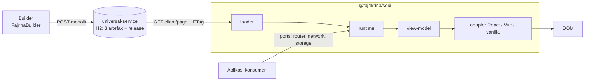
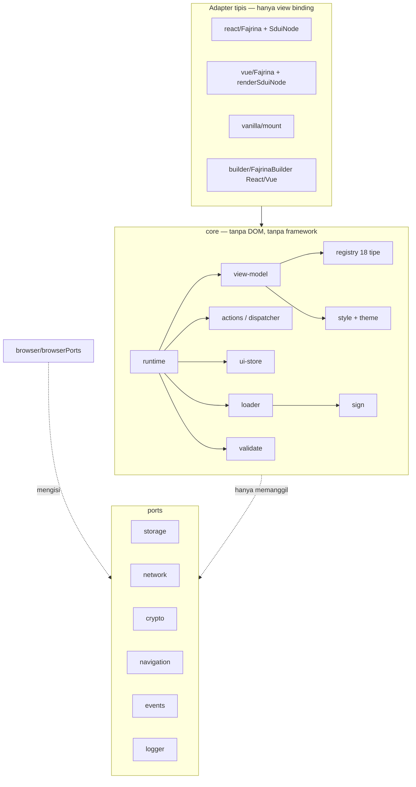
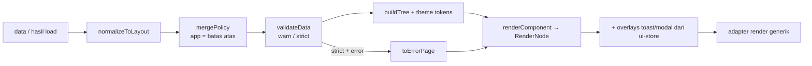
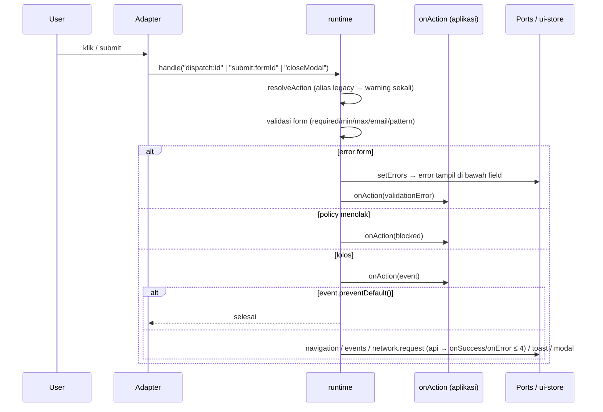
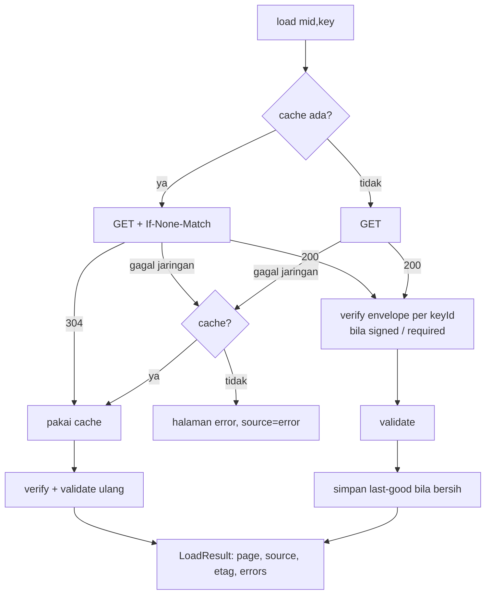

# HANDOFF — @fajekrina/sdui (library)

> Tanggal: 2026-11-10 · Versi: **0.3.0** (belum di-commit, belum di-publish)
> Desain: `DESAIN-FRAMEWORK-SDUI.md` (§13 = status implementasi) · Riwayat: `CHANGELOG.md`
> Pasangan: `universal-service/HANDOFF.md`, `react-tailwind/HANDOFF.md`, `vue-bootstrap/HANDOFF.md`

## 1. Apa ini
Renderer + runtime SDUI tanpa framework. **Core** memutuskan semuanya (validasi, policy, style, aksi, form,
toast/modal, loading). **Adapter** React/Vue/vanilla hanya merender `RenderNode` dari core, sehingga DOM-nya
identik (dibuktikan tes paritas).

## 2. Desain sistem

### 2.1 Posisi dalam sistem


### 2.2 Lapisan dan aturan ketergantungan

- `core` dilarang mengimpor react/vue atau memakai `window/document/localStorage/fetch/crypto/navigator/history` (tes `core-guard`).
- Adapter dilarang bercabang per tipe komponen atau per `behavior`; semua keputusan ada di `view-model` dan `actions`.
- `browser` satu-satunya modul yang menyentuh API browser.

### 2.3 Pipeline render

Aturan menang style: **inline > token (tema) > preset** (`buildLayoutStyle`). `position: fixed` hanya untuk Modal/Toast.
Link `javascript:` / host di luar allow-list → `href="#"`.

### 2.4 Alur aksi


### 2.5 Alur load


Pemetaan error load (`errors[0]` + `page.error.kind` → judul halaman error):

| Kondisi | `code` | `status` / `serverCode` | Judul |
|---|---|---|---|
| fetch throw / tanpa NetworkPort | `network` | – | Offline |
| 404, 410 | `http` | ✓ / `SDUI-002` | Not Found |
| 401, 403 | `http` | ✓ | Access Denied |
| 4xx lain (400, 409, …) | `http` | ✓ | Request Rejected |
| 5xx tanpa cache (dengan cache → last-good) | `http` | ✓ | Service Unavailable |
| signature / key / body bukan objek | `decode` | – | Invalid Page |
| strict + validasi gagal (runtime) | kode validasi pertama | – | Blocked |

### 2.6 Kontrak data
- **Input**: payload A1 flat `{…, policy, layout:{type,title?,subtitle?,components[{id,component|type,parentId,order,props,style}]}}` atau bentuk bersarang `children`.
- **RenderNode**: `{key, type?, element, attrs, style, text?, field?, on?, preventDefault?, stopPropagation?, children}`.
- **RenderResult**: `{nodes, overlays, errors, failed}`.
- **FajrinaActionEvent**: `{behavior, action, target, href, eventName, data, params, sourceComponent, preventDefault(), defaultPrevented}`.
- Behavior tertutup: `navigate back submit externalLink openModal closeModal toast customEvent api`.

## 3. Status
| | |
|---|---|
| Tes | `npm test` → **12 file, 115 tes lulus** |
| Typecheck | `npm run typecheck` bersih |
| Build | `npm run build` bersih (peringatan lama "named and default exports" pada entry adapter/builder) |
| Fase desain | 0–3 selesai; Fase 4 (rilis 1.0) belum |

## 4. Peta kode
```
src/core/            ← tidak boleh menyentuh DOM/framework (tests/core-guard.test.ts)
  runtime.ts         createRuntime: load / render / handle / dispatch / submit / subscribe
  view-model.ts      komponen → RenderNode (satu-satunya tempat keputusan render)
  registry.ts        18 tipe: kategori, acceptsChildren, allowedBehaviors, defaultProps
  actions.ts         resolveAction (alias legacy), checkUrl, mergePolicy, validateField
  ui-store.ts        toast / modal / nilai + error form
  loader.ts          ETag/304, last-good cache, verifikasi envelope per keyId
  ports.ts           kontrak port + default memori/no-op
  validate.ts style.ts theme.ts tree.ts sign.ts cache.ts props.ts types.ts   (dari 0.2, diperluas)
src/browser/         browserPorts(): satu-satunya modul yang memakai window/document/localStorage/fetch
src/react/           Fajrina.tsx (+useSduiRuntime), SduiNode.tsx (renderer generik)
src/vue/             Fajrina.ts (render function), SduiNode.ts (renderSduiNode, SduiNodeView)
src/vanilla/         mount(el, options)
src/builder/         builder.ts (state headless + previewNode/builderPalette/defaultPropsFor), FajrinaBuilder.tsx/.vue, BuilderNode.vue
fixtures/valid/      showcase-18 + 3 halaman merchant_demo (salinan dari universal-service) — dipakai tes paritas
```

## 5. Kontrak penting
- `<Fajrina data|source ports policy theme mode verify runtime onAction>` (React) / sama di Vue dengan `@action`, `@validationError`, `@load`.
- **`ports.navigation.navigate` default no-op** — konsumen wajib menyambungkan router (kedua demo sudah).
- `onAction` dipanggil dulu; `event.preventDefault()` membatalkan efek default. `behavior: 'blocked'` = aksi ditolak policy.
- `submit` tidak punya efek default: aplikasi yang mengirim ke backend.
- Policy aplikasi (prop) = batas atas; policy dari payload hanya mempersempit (`mergePolicy`).
- Kunci cache tetap `fajrina-page:{mid}:{key}`; entri 0.2 (tanpa ETag) tetap terbaca.
- `browserNetwork` default base `/api/universal/v1` (universal-service berversi); loader membaca pesan error dari `errorMessage` (fallback `error`), `errorCode` → `SduiError.serverCode`, status → `SduiError.status`; kode `http` vs `network` (lihat §2.5).

## 6. Cara kerja sehari-hari
```bash
npm test                 # semua gate
npm run build            # wajib sebelum demo dipakai: konsumen membaca dist/ lewat workspace junction
npx vitest run tests/parity.test.tsx   # setelah mengubah view-model/adapter
```
Menambah tipe komponen: `core/registry.ts` (descriptor) + `core/view-model.ts` (case) + `core/types.ts`
+ seed backend `V2__sdui_seed_registry.sql` (atau migrasi baru). Tidak perlu menyentuh adapter.

## 7. Diketahui / belum
- **Budget bundle**: chunk core ~12,9 KB gzip (target desain 10 KB). Belum ada `size-limit`.
- Belum ada `publint`, `@arethetypeswrong/cli`, coverage threshold, tes SSR `renderToString`.
- Gate kemurnian core berupa tes regex (bukan ESLint). Pengecualian: `cache.ts` (`loadPageWithCache`, deprecated).
- `Image.src` hanya dicek skema (data contoh memakai picsum.photos di luar allow-list).
- Builder React/Vue masih file besar dengan style inline; logika render komponen sudah dari core, tapi panel properti belum di-refactor.
- Kontrak registry core vs tabel `sdui_component_type` dijaga manual (belum ada tes kontrak lintas repo).
- Tidak diuji di browser sungguhan oleh saya: verifikasi lewat jsdom (paritas, adapter) + render Node terhadap backend live.

## 8. Langkah berikut (urut)
1. Commit + tag 0.3.0; jalankan `npm run build:all` dari root.
2. Pasang `size-limit` + kecilkan core (pisah `loader`/`sign` dari chunk runtime bila tidak dipakai).
3. CI: `publint`, `attw`, coverage ≥ 80% core, SSR test.
4. Fase 4: README per entry, TSDoc, `SECURITY.md`, hapus API deprecated → 1.0.
